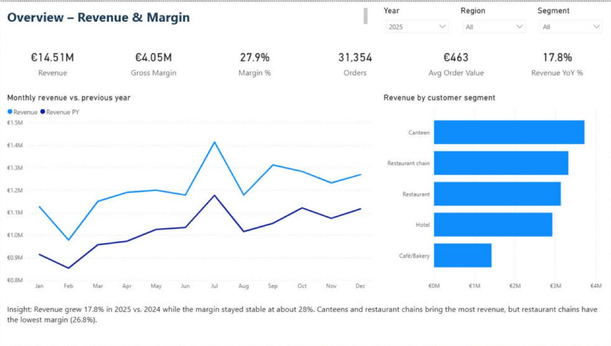
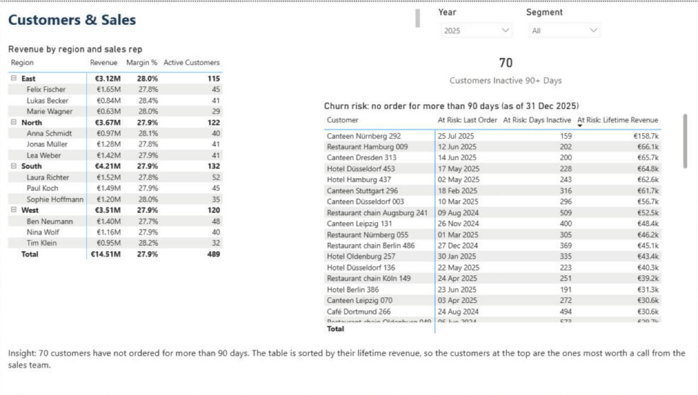
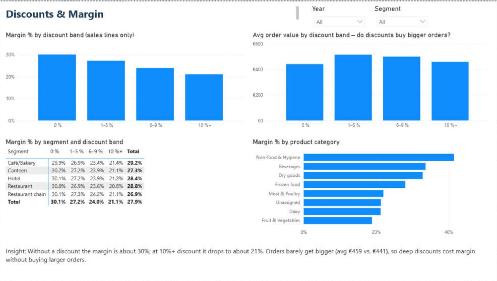
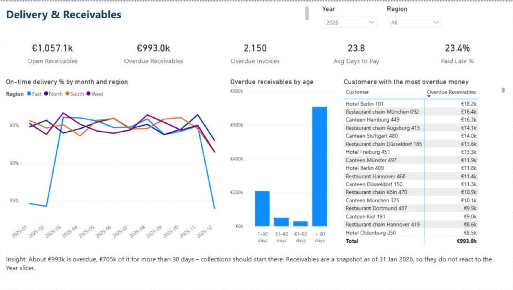

# Foodservice Sales & Margin Dashboard (Power BI)

A four-page Power BI report for a food-service wholesaler, the kind of business that supplies restaurants, hotels and canteens. It answers four management questions:

1. How are revenue and margin developing, and which customer segments drive them?
2. Are our discounts worth it?
3. Which customers are we about to lose?
4. Where do deliveries fail, and how much money is stuck in overdue invoices?

> **About the data:** the data is **synthetic**. It was generated by `scripts/generate_data.py` to look like a real ERP export, including the mess. The numbers show the method, not a real company.



## What's inside

| Step | What was done |
|---|---|
| **Power Query** | 6 raw CSV files (412,000+ order lines after cleaning) cleaned and shaped: duplicates removed, sign errors fixed, German number and date formats parsed with explicit locales, city spellings unified, German labels translated to English. All steps are in [`power_query.m`](power_query.m). Issue list: [`docs/DATA_ISSUES.md`](docs/DATA_ISSUES.md) |
| **Data model** | Star schema: 3 fact tables (sales lines, orders, invoices) and 4 dimensions (customer, product, sales rep, date). The date table is marked as a date table for time intelligence. |
| **DAX** | 25 measures: revenue, gross margin, margin %, year-over-year growth, YTD, churn risk, on-time delivery, receivables ageing. Each one has a one-line explanation in [`measures.dax`](measures.dax). |
| **Report** | 4 pages: Overview · Customers & Sales · Discounts & Margin · Delivery & Receivables. Each page ends with a one-sentence insight. |

### Data model

```
                 DimDate ──────────┐
                    │              │
DimProduct ── FactSales      FactOrders
                    │              │
                 DimCustomer ──────┘──── FactInvoices
                    │
                 DimRep
```

All relationships are many-to-one with single-direction filtering. **FactInvoices is deliberately not related to DimDate.** Receivables are a snapshot as of the data extract (31 Jan 2026), so the Year slicer should not change them.

## Key findings (2025)

| | |
|---|---|
| Revenue | **€14.51M**, +17.8% vs. 2024 |
| Margin | **27.9%**, stable vs. 2024 |
| Discounts | Margin falls from **30.1%** (no discount) to **21.1%** (10%+ discount), while average order value barely moves (€441 → €459) |
| Churn risk | **70 customers** haven't ordered for more than 90 days |
| Receivables | **€993k overdue**, of which **€705k** is more than 90 days overdue |
| Delivery | On-time delivery 94.3%; region East is lowest (92.6%) |

**Recommendations:** review the 10%+ discount tier, have the sales team call the most valuable inactive customers first, and start collections with invoices more than 90 days overdue.

## Screenshots

| | |
|---|---|
|  |  |
|  |  |

## Checking the numbers

`scripts/expected_results.py` applies the same cleaning rules in pandas and computes every KPI independently. All 27 checked KPIs match the report to the cent ([`EXPECTED_RESULTS.md`](EXPECTED_RESULTS.md)).

The check also worked the other way round. At first two payment KPIs didn't match. The cause was a bug in the Python check: `pd.to_datetime(..., dayfirst=True)` swapped day and month in ISO dates like 2024-04-07, which produced 6,385 "payments before the invoice date". Power BI's explicit per-format parsing was right. That bug is now fixed in the script.

## How to open it

1. Install **Power BI Desktop** (free).
2. Clone this repo and open `powerbi_report/Foodservice_Sales.pbip`. It is saved as a Power BI Project, which is text-based and Git-friendly. Alternatively, open `foodservice_sales.pbix`.
3. Go to *Transform data → Edit parameters* and set **DataFolder** to the full path of `data/raw/`, ending with a backslash. Then click **Refresh**.

To regenerate the data: `python scripts/generate_data.py`

## Tools

Power BI Desktop · Power Query (M) · DAX · Python (pandas) for data generation and validation
